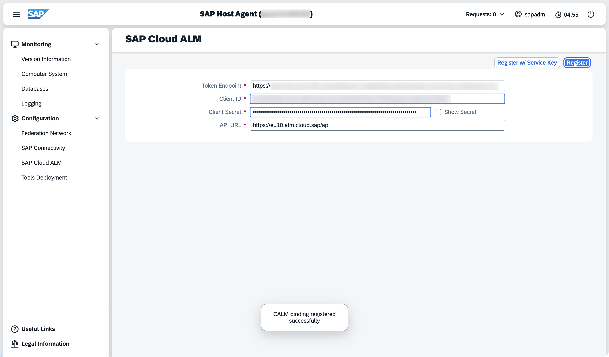

<!-- loio4d7dff56cab74dd591ae29e129c6b5d2 -->

# Web Dispatcher

This page explains how to connect SAP Web Dispatcher through Host Agent to SAP Cloud ALM to enable monitoring.

SAP Web Dispatcher supports the following monitoring applications:

-   Health Monitoring

## Prerequisites

-   You have obtained the SAP Cloud ALM service key. For more information, see [Managing Your Service Credentials](https://help.sap.com/docs/cloud-alm/setup-administration/service-key).
-   You are using at least **SAP Host Agent 722 PL72**.
-   Activate *Allow Registration for unknown systems* in *Landscape Management*. To do so, open the *Landscape Management* app and navigate to *Configuration* \> ** \> *Import of Subscribed SAP Services*. Under *Registration Settings*, set *Allow Registration for unknown systems* to *ON*.

## Setup in SAP Web Dispatcher

1.  Access the **Host Agent Login** as described in [Using SAP Host Agent WebUI](https://help.sap.com/docs/host-agent/host-agent-webui/using-sap-host-agent-webui).
2.  Navigate to *Configuration* \> *SAP Cloud ALM*.
3.  Choose *Register w/ Service Key*.
    1.  Paste the complete service key.
    2.  Choose *Register*.

## FAQ

-   **I see the same Web Dispatcher listed multiple times. Is this expected?**

    If your system has multiple instances of the same Web Dispatcher, each instance is displayed separately in *Health Monitoring*.

